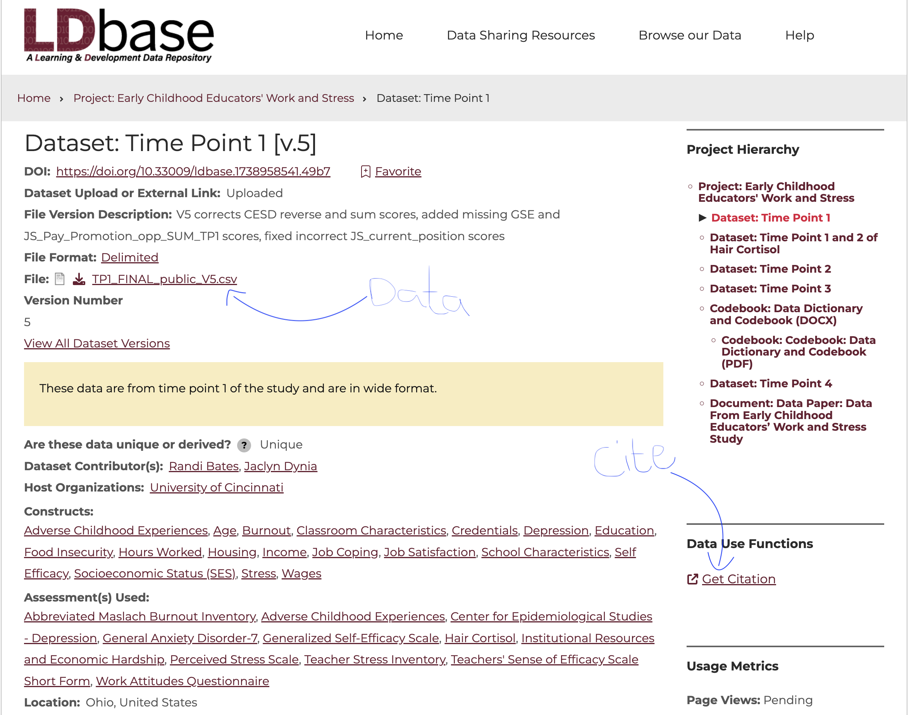

# Project Overview

The goal of this project is for you to demonstrate your ability to apply the exploratory and inferential statistical techniques and procedures we have covered in ***this course*** to a meaningful research problem from the field of psychology. You will need to browse the available data sets, their variables, etc, and come up with research questions that can be answered using the data. Your group will narrow down to two or three interesting research questions then use the various tools learned in the course to explore patterns in the data (exploratory analysis) then use statistical inference tools taught in the course to run inferential analysis. Your exploratory analysis should include both numerical statistics (e.g., means, medians, proportions, etc.) and visualizations (e.g., histograms, bar plots, box plots, etc.). Your inferential analysis should use both hypotheses tests, confidence intervals, and report effect sizes. You will then write a report that summarizes your findings and their implications.

# Research Topic and Questions

Your research topic is a brief statement that describes the general area your research questions will address. It should be broad enough to allow for multiple questions, yet specific enough to clearly convey your focus.

When developing your research questions, consider which variables in the dataset you will analyze and how they will help you answer those questions. Make sure your questions can be answered using the data available to you; avoid asking questions that cannot be supported by the dataset.

- At least one of your research questions must involve a comparison between two groups. For example, if one question focuses on inference for a single mean (simple t-test), the other should involve inference comparing two means (independent samples t-test). It is also acceptable to have both questions focus on comparisons between two groups, as long as the questions are distinct and address different variables.

# The Data

The important thing to know is that **the [Journal of Open Psychology Data](https://openpsychologydata.metajnl.com/){target="_blank"}** is primarily a catalog of data papers, not a single downloadable-data repository. Each article describes a particular psychology dataset and tells you where the actual files are hosted. The journal specifically publishes papers describing datasets with high reuse potential.

Follow these steps to find a dataset:

- Find a data paper you are interested in: Browse the journal's volumes/issues or search for a topic such as *memory*, *personality*, *Stroop*, *depression*, *social psychology*, etc.

- Open the article/PDF.

- Look for a section called something like Repository location, Data Availability, Dataset location etc. This is where the authors identify the actual repository containing the files.

- Follow the repository link. Common destinations are **OSF, GitHub, Dataverse**, or an **institutional repository**.

- Download the actual data file (Down the csv or SPSS files).

::: callout-important
- Please download the data documentation or code book as well so you can understand the variables and how they were measured.

- You will need to cite the data source in your report, so note down the citation guide given on the page.
:::

Here is an example of a data landing page:

{width="663"}

## Other Data Sources

The following data sources are not specific to psychology but you may explore them to see if there is any data that fits your needs.

- [Kaggle](https://www.kaggle.com/datasets): This is a platform for predictive modeling and analytics competitions in which companies and researchers post data and statisticians and data miners from all over the world compete to produce the best models.

- [Openintro](https://www.openintro.org/data/) website: This website contains data sets from various domains. Look for any domains that might be relevant to your research. For example, [Youth Risk Behavior Survey (YRBS)](https://www.openintro.org/data/index.php?data=yrbss) is a survey conducted by the CDC to monitor health-risk behaviors among youth and young adults in the United States.

- [FiveThirtyEight](https://data.fivethirtyeight.com/): This is an American website that does opinion poll analysis on politics, economics, and sports in the United States. 538 shares their data sets, related articles, and code.

**Your chosen data set should meet the following criteria:**

- Must have at least 60 subjects (rows) and 3 variables (columns).

- Have both continuous and discrete variables or describe a plan of modifying existing variables to create new ones.

- You may not use data that has previously been used in any course materials, such as labs or class activities. If you must use a data set that has been used in the course, you must get approval from the instructor first. The approval will be granted depending on how your proposed analyses and research questions differ from those used in the course.

- You are free to reuse data from the first project, but you must have a new research question and new analyses. You may not use the exact same research questions and analyses from the first project.

If you are unsure whether your chosen data meets the above criteria, please check with me.

# Final Project Report

Your project report should be written in a clear and concise manner using the Times New Roman font, 12-point, and double-spaced). You must include labelled and titled graphics and tables from SPSS in your report to support your findings.

The report will include the following sections:

## Abstract

The abstract should be a brief summary of your research topic, questions, data, methods, and main findings. It should be no more than 350 words. It is best to write the abstract after you are done with all the other parts of the project.

Click on the following link to read an example of a well written abstract:

[Sample Abstract](https://cornerstone.lib.mnsu.edu/urs/2022/poster-session-01/4/)

## Introduction

The introduction section introduces your topic and provides the background. In this section, you will need to provide a rationale for your chosen topic and/or questions and describe why we should care. Consider citing a few articles in the introduction section to help you make your case.

## Research Questions & Hypotheses

Write down two research questions that you will answer in your study. Both questions should clearly relate to your research topic. Avoid including unrelated questions, as this may indicate that you are conducting two separate studies within one project. The variables of interest should be clearly identified in each question.

Since each question will be answered using inferential statistics, you should write down the hypotheses corresponding to each question. The analyses will be done in SPSS.

## Literature Review

Find 5 to 7 articles related to your topic, read them, and synthesize their findings to summarize what previous researchers have reported. The goal is to place your study within the context of existing literature. This section should be approximately five paragraphs in length.

## Methodology

The methods section should describe the data and the methods used to analyze the data. This section should include the following subsections:

### Sample and Data Collection Methods

Describe your sample, the participants involved, and their demographic characteristics (e.g., age, gender, etc). How large is the sample and how was it collected (e.g., what instruments were used?). What is the target population? What sampling method(s) was used and how does this impact whether or not the sample is representative of the population?   ***Note that*** since you are using existing data that you did not collect, you are allowed to speculate on some of the data collection techniques as long as the speculation seems reasonable. You will do this only when you cannot find enough documentation for the data set of your choice.

### Description of Data Analysis Techniques

Briefly **describe** the data analysis techniques you will use to answer each of your research questions and justify your choices. This section should include a description of the variables used in the analysis, including their types (continuous or discrete) and their measurement levels (nominal, ordinal, interval, or ratio). You should also explain any data cleaning or transformations performed prior to the analysis. If you created a discrete variable from a continuous variable, describe this step and provide a rationale for doing so.

Finally, outline the statistical methods you will use to analyze the data. Your description should include both exploratory and inferential analyses. Exploratory analysis should include summary statistics and data visualizations. Inferential statistics should include hypothesis tests, confidence intervals, and effect sizes. You must also provide a justification for your choice of analysis methods (e.g., inference for two independent means is appropriate because the question involves....).

## Data Analysis, Results, and Discussion

In this section, you will carry out the analyses described above and report your findings. All outputs (such as graphs, summary statistics, t-test tables, etc) must be accompanied by interpretations in the context of your study and should directly address the original research questions. Be sure to label all outputs (figures and tables) in your report. Any graphics that you do not generate yourself must be properly cited. If possible, include clickable links within the document for easy navigation by the reader.

Organize the section by research question. For each question, include both exploratory and inferential analyses. It is standard to start with exploratory analyses, followed by inferential analyses.

## Conclusion

Finally, you will need to write a conclusion for your study. In the conclusion, you want to **briefly restate** what you set out to do and **how** you went about it. Give some **brief summary on the data** used, data explorations/analyses performed and the **results obtained**. State the **insights** drawn from the study and **compare to existing findings** reported under literature review section. Discuss the **potential implications** of your work (i.e., what practical consequences does your study have?) Lastly, reflect on **limitations** of your study and how future similar studies might be better designed.

## References

All sources used should be cited both in text and listed under references. Use the APA format. You may find the APA referencing guide on [this link](https://owl.purdue.edu/owl/research_and_citation/apa_style/apa_formatting_and_style_guide/index.html).

# Grading Rubric

The project will be graded out of 100 points. The following rubric will be used to grade the project.

### Quality of Written Report

+-----------+-----------------------------------------------------------------------------------------------------+
| Points    | Description                                                                                         |
+===========+=====================================================================================================+
| 10        | - Organization and structure are good, report is easy to follow and interesting to read.            |
|           |                                                                                                     |
|           | - No grammatical errors/typos.                                                                      |
|           |                                                                                                     |
|           | - Graphs are well labelled and incorporated into the body of the report alongside software outputs. |
|           |                                                                                                     |
|           | - References provided in APA format.                                                                |
+-----------+-----------------------------------------------------------------------------------------------------+
| 9         | - A few minor grammatical, spelling, and/or formatting errors.                                      |
|           |                                                                                                     |
|           | - Minor APA formatting errors.                                                                      |
+-----------+-----------------------------------------------------------------------------------------------------+
| 8         | - Weak introduction/rationale and/or a fair amount of grammatical, spelling errors.                 |
|           |                                                                                                     |
|           | - Incomplete reference list or missing some citations.                                              |
+-----------+-----------------------------------------------------------------------------------------------------+
| 6         | - Report is not well-structured.                                                                    |
|           |                                                                                                     |
|           | - Discussion is difficult to follow or is too shallow/vague.                                        |
+-----------+-----------------------------------------------------------------------------------------------------+
| 4         | - Graphs/software output not included in the body of the report.                                    |
|           |                                                                                                     |
|           | - Structure of report is sloppy.                                                                    |
|           |                                                                                                     |
|           | - No apparent proofreading.                                                                         |
+-----------+-----------------------------------------------------------------------------------------------------+
| \< 4      | - Even more problematic (e.g., no citations at all).                                                |
+-----------+-----------------------------------------------------------------------------------------------------+

### Design and Methodology of the Study

+---------+---------------------------------------------------------------------------------------------------------------------------------------------------------------------------------+
| Points  | Description                                                                                                                                                                     |
+=========+=================================================================================================================================================================================+
| 18 - 20 | - Innovative topic with precaution taken and detail considered. Description of methods is clear and complete (another person could follow the protocol to replicate the study). |
|         |                                                                                                                                                                                 |
|         | - Design is appropriate for both research questions.                                                                                                                            |
|         |                                                                                                                                                                                 |
|         | - Complete analyes techniques, with justifications are provided for both questions.                                                                                             |
+---------+---------------------------------------------------------------------------------------------------------------------------------------------------------------------------------+
| 16 - 17 | - Design not as innovative and extensive.                                                                                                                                       |
|         |                                                                                                                                                                                 |
|         | - Discussion of design missing minor components (see project descriptions above).                                                                                               |
+---------+---------------------------------------------------------------------------------------------------------------------------------------------------------------------------------+
| 13 - 15 | - Design is reasonable but not appropriate for one of the stated research questions.                                                                                            |
|         |                                                                                                                                                                                 |
|         | - Discussion misses major components.                                                                                                                                           |
|         |                                                                                                                                                                                 |
|         | - Little creativity or originality is demonstrated.                                                                                                                             |
+---------+---------------------------------------------------------------------------------------------------------------------------------------------------------------------------------+
| \< 13   | - Design is broken and not appropriate for at least one question.                                                                                                               |
|         |                                                                                                                                                                                 |
|         | - Minimal consideration of basic principles discussed in the course.                                                                                                            |
+---------+---------------------------------------------------------------------------------------------------------------------------------------------------------------------------------+

### Analyses and Interpretations

+-----------+----------------------------------------------------------------------------------------------------------------+
| Points    | Description                                                                                                    |
+===========+================================================================================================================+
| 30 - 35   | - Both exploratory and inferential analyses done properly for both research questions.                         |
|           |                                                                                                                |
|           | - Software outputs are properly interpreted in context and in enough detail to address the research questions. |
|           |                                                                                                                |
|           | - Language is clear and precise. Not overly technical.                                                         |
+-----------+----------------------------------------------------------------------------------------------------------------+
| 25 - 29   | - Interpretations are vague or imprecise, but seem largely correct and complete.                               |
|           |                                                                                                                |
|           | - Insights not well integrated or not fully substantiated by analyses.                                         |
+-----------+----------------------------------------------------------------------------------------------------------------+
| 20 - 24   | - Insufficient output provided.                                                                                |
|           |                                                                                                                |
|           | - Major errors in statistics and/or weak interpretation of software outputs.                                   |
|           |                                                                                                                |
|           | - No or minimal insights drawn from the analyses.                                                              |
+-----------+----------------------------------------------------------------------------------------------------------------+
| \< 20     | - Project does not consider two separate questions.                                                            |
|           |                                                                                                                |
|           | - Analyses are incomplete and/or inappropriate for the data or research questions.                             |
|           |                                                                                                                |
|           | - Report does not provide interpretations or interpretations are inconsistent and contradictory.               |
+-----------+----------------------------------------------------------------------------------------------------------------+

### Conclusion

+----------+--------------------------------------------------------------------------------------------------------------------------+
| Points   | Description                                                                                                              |
+==========+==========================================================================================================================+
| 8 - 10   | - Discussion summarizes the study, including methods, key findings, implications, and considerations of future research. |
|          |                                                                                                                          |
|          | - Ties to existing literature as reported in the literature review section.                                              |
|          |                                                                                                                          |
|          | - Highlights potential implications of the study.                                                                        |
|          |                                                                                                                          |
|          | - Highlights any limitations and suggestions for future improvement.                                                     |
+----------+--------------------------------------------------------------------------------------------------------------------------+
| 6 - 7    | - Conclusion lacks one of the important components stated above.                                                         |
+----------+--------------------------------------------------------------------------------------------------------------------------+
| 4 - 5    | - Conclusion lacks multiple components and is generally hard to follow.                                                  |
+----------+--------------------------------------------------------------------------------------------------------------------------+
| \< 4     | - Even more problematic.                                                                                                 |
+----------+--------------------------------------------------------------------------------------------------------------------------+

**Note** that the above points total to 75. As a group, your will be graded out of 75. The rest of the points (25) will come from your presentation (each member is expected to take part) and individual contribution to the project (you will complete a project assessment). This means that members in the same group may not earn the same grade.
