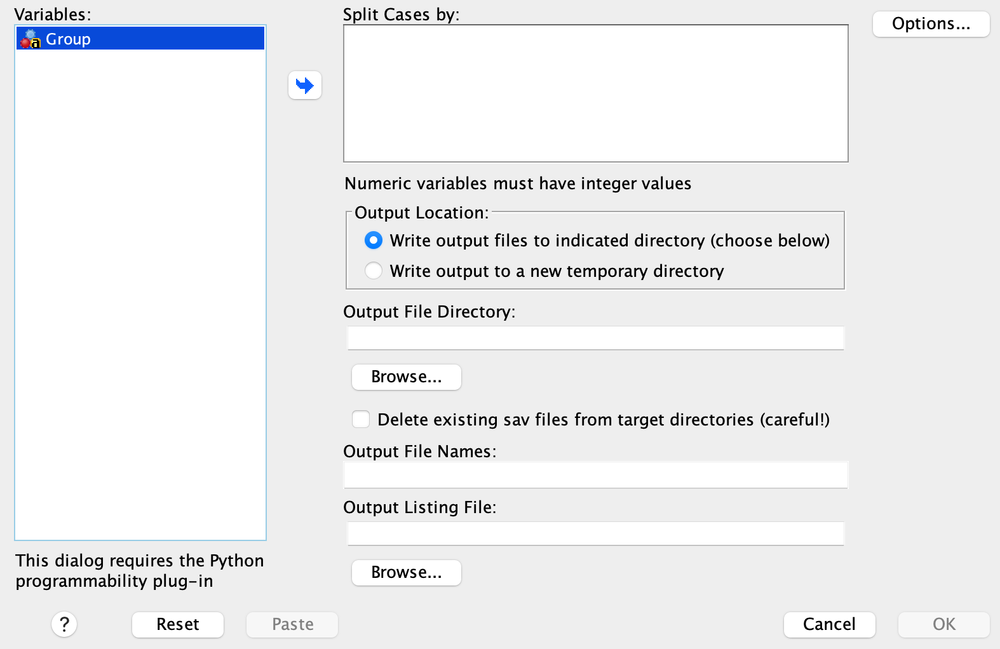

## Overview Scenario

In this lab, we will explore the use of the t-test to compare a sample mean to a known population mean. We will use SPSS to perform the calculations and interpret the results.

Here is the scenario:

A fitness center wants to determine if their new weight loss program is effective. It is believed that the average weight loss for individuals who participate in a weight loss program with financial incentives is 15 pounds over a 4-month period. The fitness center wants to see if their program leads to a different average weight loss than this known population mean.

To investigate this, the center recruited 38 individuals who wanted to lose weight and randomly assigned them to either a incentive group (given financial incentives) or a control group (not given any financial incentives). After 4 months, the researchers recorded the amount of weight lost (before - after) by each individual. Three months after the initial 4 months, they also recorded the weight lost by each individual again to see if the weight loss was maintained. However, financial incentives were only given during the first 4 months. 

::: {.callout-note title="Learning Objectives"}
By the end of this lab, you should be able to:

- State null and alternative hypotheses for a population mean.
- Perform a one-sample t-test in SPSS.
- Interpret the results of a one-sample t-test in the context of a research question.
:::

## Part 1 — The Data & Hypotheses

## The Data

The data collected is available in the following link: 

[Weight Loss Data](datasets/weightLossIncentive.csv). 

Download the data and import them into SPSS.

**File \> Import Data \> CSV Data...**, browse to the file location, and click **OK** on the import wizard (accept the default settings).

Make sure the measurement scales are set as follows and that there are 38 rows:

- `WeightLoss` = Scale
- `Group` = Nominal
- `Month7Loss` = Scale

::: {.callout-tip title="variable Description"}

The variable description is as follows:

- ***Group*** = Whether someone was in the Incentive or Control group.- WeightLoss = The amount of weight lost by each individual

- ***Weightloss*** = The amount of weight lost by each individual at the 4-month follow-up. 

- ***Month7Loss*** = The amount of weight lost by each individual at the 7-month follow-up

:::

## Stating Hypotheses

Null Hypothesis: The average weight loss for individuals in the incentive group is still equal to 15 pounds.

In symbols: $H_0: \mu = 15$

Alternative Hypothesis: The average weight loss for individuals in the incentive group is different from 15 pounds. 

In symbols: $H_1: \mu \neq 15$

## Part 2 — Data Filtering 

We are only interested in the individuals in the incentive group for this lab. One way to isolate the incentive group is to use the **Split into files** feature in SPSS. Here are the steps:

Data \> Split into Files. The following window will pop up:

{fig-align="center" width="639"}

Send the `Group` variable into the **Split Cases by** box, then click on **Browse** to specify the file location then click **OK**.

Next, navigate to the file location in your computer and open the file named `Incentive.sav`. Notice that this file contains only members of the incentive group and their weight loss variables. 

## Part 3 — Exploratory Analysis

Before running the t-test, we will perform some exploratory analysis to understand the data better. We can start by exploring the spread of the data using a box plot:

Run the following steps:

Graphs \> Chart Builder \> Boxplot. Move `WeightLoss` into the **Y-axis** box. Click **OK**.

::: {.callout-tip title="Checkpoint "}
Based on the box plot, how would you describe the spread and shape of the `WeightLoss` variable for the incentive group? Are there any suspected outliers?

:::

::: {.callout-tip title="Checkpoint "}
Generate a histogram to visualize the distribution of the `WeightLoss` variable. What aspects of the distribution can discern based on the histogram that you cannot discern from the box plot?
:::

::: {.callout-tip title="Checkpoint "}
Calculate the summary statistics (mean, median, standard deviation, minimum, maximum) for the `WeightLoss` variable. Comments on the range and standard deviation.
:::

## Part 4 — Running the t-test

To run the one-sample t-test, follow these steps:

- Analysis \> Compare Means and Proportions \> One-Sample T Test. 
- Move `WeightLoss` variable into the **Test Variable(s)** box. 
- Enter `15` in the **Test Value** box. Make sure the "Estimate effect size" checkbox is checked.
- Click on **Options** and check that the confidence interval is set to 95%. Click **Continue**.
- Click **OK**.

### Output Interpretation

The output will provide you with the t-statistic, degrees of freedom, p-value (one-sided and two-sided), and the confidence interval, among others.

Here is an APA-style interpretation of the results:

## Take-Home Lab Exercises

TBD

## Submission Checklist

- [ ] A saved SPSS data (.sav) file showing the variables and data (includes $z-scores$).
- [ ] SPSS output file (.spv) showing the analyses performed.
- [ ] Completed responses for the Questions above. This document should be typed (Times New Roman, Font size 12, double spaced). The document should include necessary SPSS output tables and graphs. Remember that SPSS output tables and graphs can be copied and pasted into a word document.
