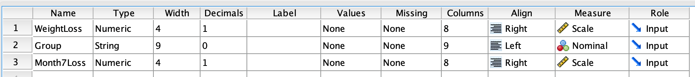
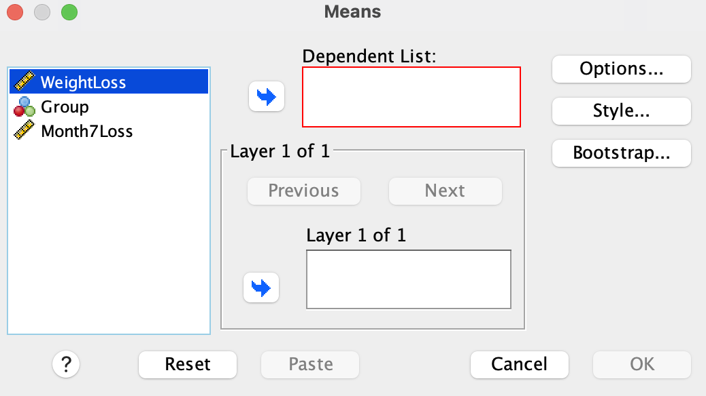
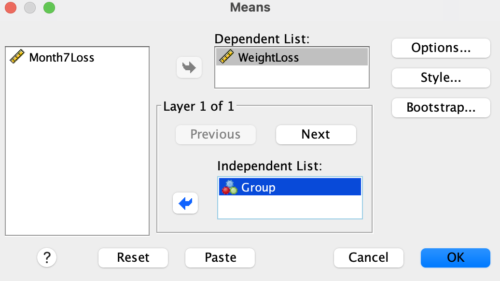
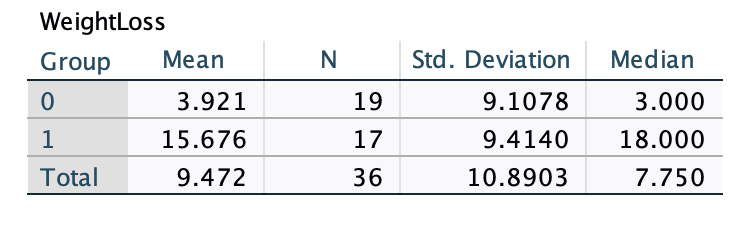
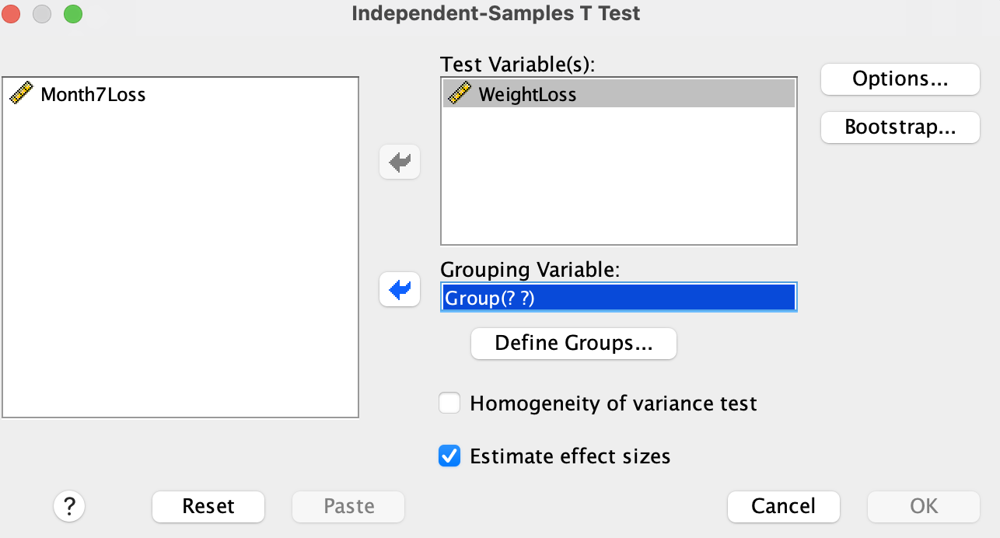
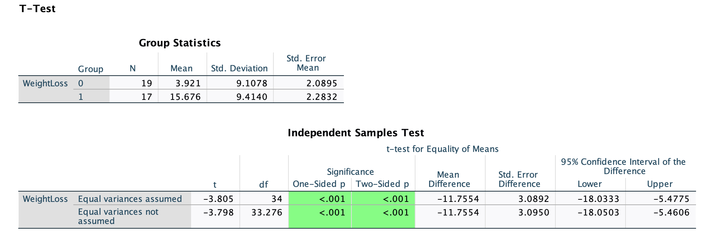

-------------------

## Part 1: Scenario & Overview
In the previous lab, we performed a ***one-sample t-test*** to determine if the average weight loss for individuals in the incentive group was significantly different from the known population mean of 10 pounds. In this lab, we will perform a ***two-sample t-test*** to determine if there is a significant difference in average weight loss between the incentive group and the control group.

Here is the research question we will be investigating:

::: {.callout-tip title="Research Question"}
Does the new weight loss program with financial incentives result in a significantly higher average weight loss than the traditional weight loss program without financial incentives? 
:::

Here is the scenario to that we will be working with:

A fitness center wants to determine if using financial incentives is associated with greater weight loss among participants. The fitness center has a new weight loss program that offers financial incentives to individuals who meet their weight loss goals. The center wants to determine if the new program is more effective than the traditional weight loss program that does not offer financial incentives.

**Study Design:** The researchers recruited 38 individuals who wanted to lose weight and randomly assigned them to either an incentive group (given financial incentives) or a control group (not given any financial incentives). After 4 months, the researchers recorded the amount of weight lost (before - after) by each individual. Three months after the initial 4 months, they also recorded the weight lost by each individual again to see if the weight loss was maintained. However, financial incentives were only given during the first 4 months.

::: {.callout-note title="Learning Objectives"}
By the end of this lab, you should be able to:

- State null and alternative hypotheses for an independent samples t-test.
- Perform an independent samples t-test in SPSS.
- Interpret the results of an independent samples t-test in APA style.
:::

### Stating Hypotheses

Null Hypothesis: There is no difference in average weight loss between individuals in the incentive group and the control group.

In symbols: $H_0: \mu_1-\mu_2 = 0$

Alternative Hypothesis: There is a difference in average weight loss between individuals in the incentive group and the control group.

In symbols: $H_1: \mu_1-\mu_2 \neq 0$

### Checking Assumptions

There are two main assumptions to consider before running a one-sample t-test:

- **Independence:** The individuals in the study must be independent, meaning that each participant or observation belongs to only one group. In this study, the individuals were randomly assigned to either the incentive or control group, so this assumption is satisfied.

- **Normality:** The distribution of the dependent variable (weight loss) should be approximately normal for each group. We will check this assumption using visualizations and summary statistics in the next section. With large samples (n > 30), the t-test is robust to violations of normality, but with smaller samples, it is important to check this assumption.
- **No Significant Outliers:** The dependent variable should not have any significant outliers. We will check for outliers using box plots in the next section.
- **Homogeneity of Variance:** The variance of the dependent variable (weight in this case) should be approximately equal for both groups.

-------------------

## Part 2: The Data

### Importing Data into SPSS

The data set is available in the following link. Download the data.

[WeightLoss](datasets/weightLoss.csv).

After downloading the dataset, import it into SPSS, using the following steps:

**File \> Import Data \> CSV Data...**, browse to the file location, and click **OK** on the import wizard (accept the default settings).

Make sure the measurement scales are set as follows:  `WeightLoss` = Scale, `Group` = Nominal, `Month7Loss` = Scale.

See the screenshot below for reference:

{fig-align="center" width="739"}

::: {.callout-tip title="variable Description"}

The variable description is as follows:

- ***Group*** = Whether someone was in the Incentive or Control group. **0=Control group, 1=Incentive group**.

- ***Weightloss*** = The amount of weight lost by each individual at the 4-month follow-up.

- ***Month7Loss*** = The amount of weight lost by each individual at the 7-month follow-up
:::

Click on data view to confirm that you have 38 individuals in the data set. The `WeightLoss` variable is calculated as the difference between the weight before and after the 4-month period. Negative values (e.g., case 14) indicate that the individual gained weight. 

The goal is to determine if the average initial weight loss (`Weightloss`) for individuals in the incentive group is significantly different from the average weight loss for individuals in the control group.

-------------------

## Part 3: Exploratory Analysis

Before running the t-test, we will perform some exploratory analysis to understand any patterns/trends in the data. 

### Summary Statistics

First, we want to generate a table of summary statistics for the `WeightLoss` variable. Run the following steps:

Analyze \> Compare Means and Proportions \> Means.

The following dialog box should appear:

{fig-align="center" width="600"}

Send the `WeightLoss` variable into the **Dependent List** box and the `Group` variable into the **Independent List** box. See below:

{fig-align="center" width="600"}

Click **OK**.

Optionally, you may click on **Options** during the variable selection to select step above for additional summary statistics (e.g., median, range, etc.) to include in the output.

You should see the following table in the output window:

{fig-align="center" width="600"}

::: {.callout-tip title="Output Interpretation"}
The table shows the the individuals in the control group (recorded as 0) on average lost $M = 3.921$ lbs with $SD = 9.1$ lbs, while the individuals in the incentive group (recorded as 1) on average lost $M = 15.68$ lbs with $SD = 9.41$ lbs. Based on this information, we can see that the variance in weight loss is similar between the two groups, hence satisfying the assumption of homogeneity of variance.
:::

### Visualizations

We can create a side-by-side box plot to visualize the distribution of the `WeightLoss` variable for both groups. Run the following steps:

- Graphs \> Chart Builder \> Boxplot.
- Select the **Simple Boxplot** from the gallery and drag the plot into the **preview** window. 
- Drag the `WeightLoss` variable into the **Y-axis** box and the `Group` variable into the **X-axis** box.
- Click **OK**. 

::: {.callout-tip title="Checkpoint "}
Describe the spread and shape of the `WeightLoss` variable for both groups. Are there any suspected outliers in either group?
:::

-------------------
## Part 4: Running the t-test

To run the independent samples t-test, follow these steps:

- Analysis \> Compare Means and Proportions \>  Independent Samples T Test.
- Send the `WeightLoss` variable into the **Test Variable(s)** box and the `Group` variable into the **Grouping Variable** box. See below:

{fig-align="center" width="600"}

- Next, click on **Define Groups** and enter 0 for Group 1 and 1 for Group 2. 
- Click **Continue**.

The following tables should pop up in the output window:

{fig-align="center" width="750"}

The output shows both summary statistics and the results of the independent samples t-test. The summary statistics include the mean, standard deviation, and standard error. The t-test results (second table) include the t-statistic, degrees of freedom, p-value (one-sided and two-sided), and the confidence interval. In this case, we will use the first row that assumes equal variances.

The P-value measures the chance of obtaining an average difference in weight loss of 11.75 or more extreme if the null hypothesis (average difference = 0) is true. Our obtained P-value is extremely small (less than the significance level of 0.05), so we reject the null hypothesis which states that there is no difference in average weight loss between the incentive and the control groups. This means that the data provides string evidence that the difference in average weight loss between the incentive and the control groups is statistically significant. In other words, the average weight loss for individuals in the incentive group is significantly higher than the average weight loss for individuals in the control group. 

------------
## Part 5: Output Interpretation

