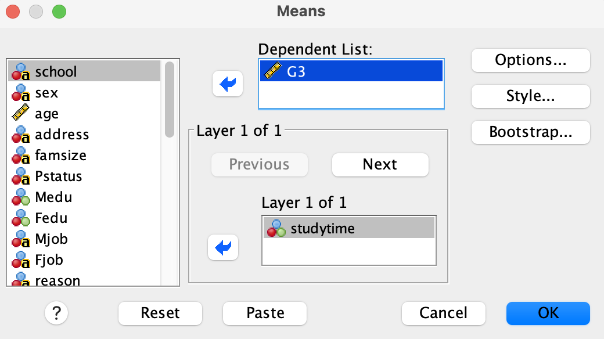
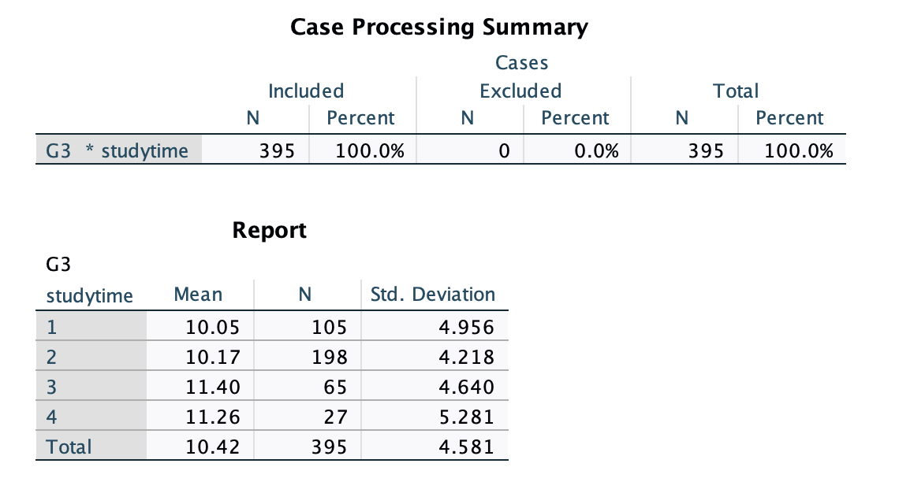
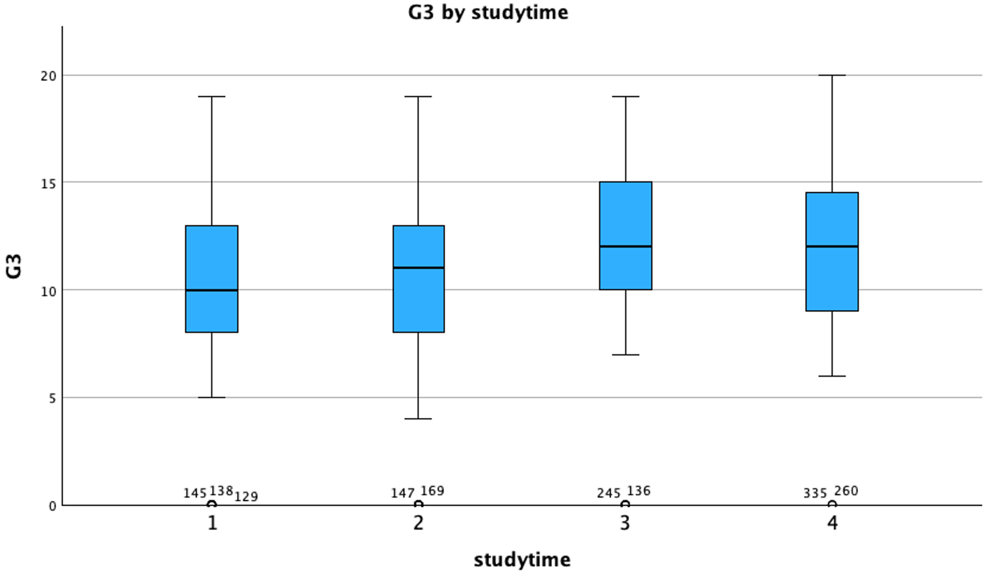
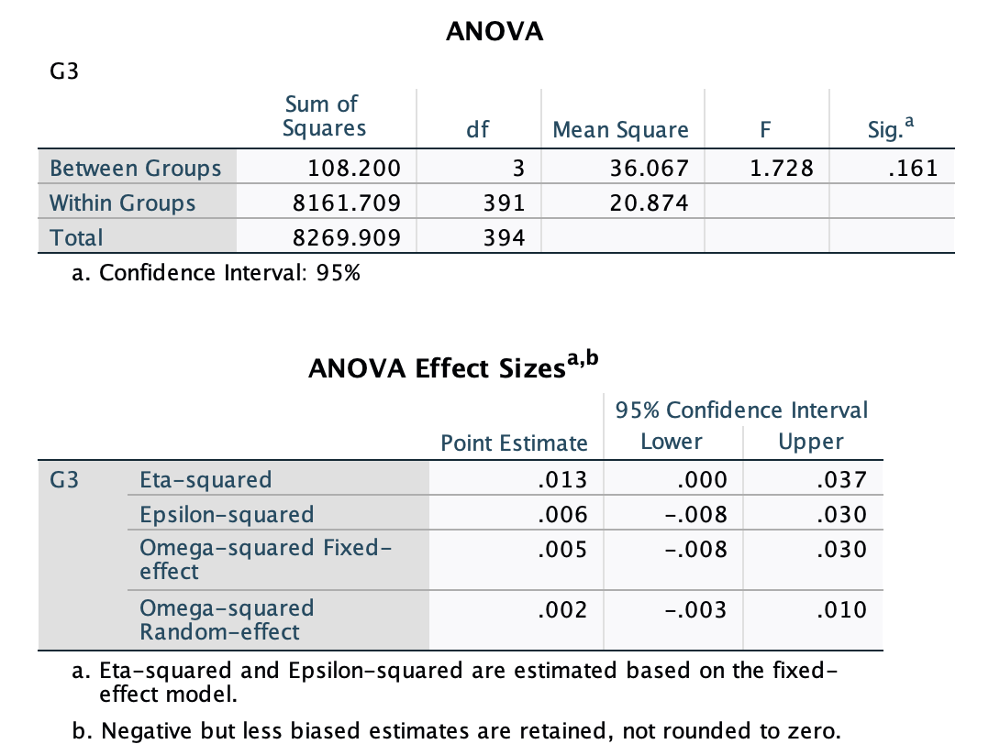

------------------------------------------------------------------------

## Part 1: Scenario & Overview

In the previous lab, we performed an ***Independent Samples t-test*** in which we tested whether there was a difference in average weight loss (in lbs) between individuals in the incentive and non-incentives groups. In that scenario, we had only two groups to compare. But what if we have have more than two groups? How can we compare means from three or more groups?

In today's lab, we introduce a new inference tool known as ***Analysis of Variance (ANOVA)***. This statistical method is used to compare the means of **three or more groups** to determine if at least one group mean is significantly different from the others. ANOVA helps us understand whether the observed differences in sample means are likely due to random chance or if they reflect true differences in the population.

Here are the objectives for this lab:

::: {.callout-tip title="Objectives"}
- Explore the concept of ANOVA and its application in comparing means across multiple groups.
- State the assumptions underlying ANOVA and how to check them.
- State the null and alternative hypotheses for ANOVA.
- Perform ANOVA using SPSS and interpret the results in APA format.
:::

**Scenario:**

Psychologists interested in learning and academic achievement often investigate whether the amount of time students spend studying is associated with academic performance. A research team wants to investigate whether students’ final mathematics grades differ depending on how much time they spend studying each week. The data were collected using school reports and questionnaires and include information on students' demographics, family background, study habits, and academic performance.

The data set is available at the [UC, Irvine Machine Learning Repository](https://archive.ics.uci.edu/dataset/320/student+performance). and can be downloaded from the link below:

[Student Mathematics Data](datasets/student-mat.csv){download=""}.

**Important limitation:** The data are observational. An association between study time and grades does not establish that studying more causes higher grades.

### Research Questions and Hypotheses

**Research question:** Do students who spend different amounts of time studying each week have significantly different average final mathematics grades?

**Research Hypotheses:**

Null Hypothesis (H0): There is no significant difference in the average final mathematics grades among students who spend different amounts of time studying each week.

In symbols: $H_0: \mu_1=\mu_2 = \mu_3 =0$ (where $\mu_1$, $\mu_2$, and $\mu_3$ represent the population means of final mathematics grades for the different study time groups).

Alternative Hypothesis (HA): At least one group mean is significantly different from the others.

In symbols: $H_A: \text{At least one } \mu_i \text{ is different}$ (where $\mu_i$ represents the population means of final mathematics grades for the different study time groups).

### Checking Assumptions

Before conducting ANOVA, it is essential to check the following assumptions:

- **Independence:** The individuals in the study must be independent, meaning that each participant or observation belongs to only one group. In this study, the students study times were grouped such that each student belongs to only one study time category, ensuring independence.

- **Normality:** The distribution of the dependent variable (final mathematics grades) should be approximately normal within each group. This can be assessed using visual methods (e.g., histograms, Q-Q plots) or statistical tests (e.g., Shapiro-Wilk test).

- **Equality of Variances (Homoscedasticity):** The variances of the dependent variable should be approximately equal across the groups. This can be assessed using Levene's test and/or by visually inspecting boxplots.

## Part 2: The Data

### Importing Data into SPSS

As noted earlier, the data set is available at the [UC, Irvine Machine Learning Repository](https://archive.ics.uci.edu/dataset/320/student+performance) and can be downloaded directly from the link:

[Student Mathematics Data](datasets/student-mat.csv){download=""}.

Doanload the .csv file and import it into SPSS, using the following steps:

**File \> Import Data \> CSV Data...**, browse to the file location, and click **OK** on the import wizard (accept the default settings).

### Variables of Interest

The data set has many variables, but we are interested in the following variables:

- **studytime:** A discrete (categorical) variable representing the amount of time students spend studying each week. The variable has four levels as described below. You can think of this variable as a factor variable (groups) in ANOVA, which will allow us to compare the means of the final mathematics grades across these four groups.
  - 1: Less than 2 hours
  - 2: 2 to 5 hours
  - 3: 5 to 10 hours
  - 4: More than 10 hours
- **G3:** A continuous variable representing the final mathematics grade of students, ranging from 0 to 20.

::: {.callout-caution title="Variable Setup"}
Before you proceed, click on the **Variable View** tab and make sure the variable G3 is set to **Scale** and the variable studytime is set to **Nominal**. This will ensure that SPSS treats the variables correctly during the analysis.
::: 

## Part 3: Exploratory Data Analysis (EDA)

Before conducting ANOVA, it is important to perform exploratory data analysis (EDA) to understand the distribution of the dependent variable (G3) across the different levels of the independent variable (studytime). This will help us check the assumptions of normality and equality of variances.

We can start by generating a table of descriptive statistics for the final mathematics grades (G3) across the different study time groups (studytime). This will provide us with the mean, standard deviation, and sample size for each group.

Follow these steps:

- Analyze > Compare Means and Proportions > Means.
- Move the variable G3 to the **Dependent List** box and the variable studytime to the **Independent List** box. See screenshot below.
{fig-align="center" width="600"}
- Click **OK** to generate the output.

The following output should appear in the output file:
{fig-align="center" width="600"}

The mean final mathematics grades (G3) for the three study time groups appear very similar, with means of 11.5, 11.9, 12.0, and 12.3 for the four groups, respectively. The standard deviations are also relatively similar across the groups, ranging from 3.2 to 3.6. We also notice that level 4 (more than 10 hours) and level 3 (5 to 10 hours) study hours had the fewest number of students at $n=27$ and $n=67$ respectively.

Next, we can visualize the distribution of final mathematics grades (G3) across the different study time groups (studytime) using boxplots. This will help us assess the assumptions of normality and equality of variances.

Follow these steps to create boxplots:

- Graphs > Chart Builder.
- In the Chart Builder dialog box, select **Boxplot** from the gallery and drag the **simple box plot** to the chart preview area.
- Drag the variable G3 to the **Y-Axis** box
- Drag the variable studytime to the **X-Axis** box.
- Click **OK** to generate the boxplot.

You should see the following output in the output file:

{fig-align="center" width="700"}

The boxplots show the distribution of final mathematics grades (G3) for each study time group. We can observe that the medians are relatively similar across the groups, and there are a few suspected outliers in each group. These students appear to have scored 0 and it is possible that they missed the exam. However, we will still check the assumptions of normality and equality of variances more formally.

------------------------------------------------------------------------

## Part 4: Running the ANOVA test

To run the ANOVA test in SPSS, follow these steps:

- Analyze > Compare Means and Proportions > One-Way ANOVA.
- Move the variable `G3` to the **Dependent List** box and the variable `studytime` to the **Factor** box.
- Click on the **OK** 

The output will display the ANOVA table, which includes the F-statistic, degrees of freedom, and p-value as shown below:

{fig-align="center" width="600"}

## Part 5: Output Interpretation

The ANOVA table shows the F-statistic, degrees of freedom (computed as number of groups minus 1), and p-value, among others. In this case, the F-statistic is 1.728 with a p-value of 0.161. The test statistic in ANOVA is called the `F-statistic` and it measures the ratio of **between-group variance** to **within-group variance**. The larger the F-statistic, the more likely it is that the group means are significantly different.
In our case, since the p-value is greater than the significance level of 0.05, we fail to reject the null hypothesis. We conclude that the data does not provide enough evidence to suggest that there is a significant difference in the average final mathematics grades among students who spend different amounts of time studying each week.

The effect size is commonly reported in ANOVA as **eta squared, $\eta^2$**, which represents the proportion of the total variance in the dependent variable that is attributable to the independent variable. In this case, the effect size is 0.013, which indicates a very small effect of study time on final mathematics grades.

::: {.callout-tip title="APA-style Write-up"}
Here is an example of how to write up the results of the ANOVA test above in APA style. This is what you would include in the results section of a research paper:

A one-way ANOVA was conducted to examine whether students’ final mathematics grades differed based on the amount of time they spent studying each week. The results indicated that there was no statistically significant difference in the average final mathematics grades among the four study-hour groups, F(3, 391) = 1.73, p = .161, η² = .013. The effect size was small, indicating that study hours explained approximately 1.3% of the variability in students’ final mathematics grades.
::: 

## Take-Home Lab Exercises

In this lab, we have learned how to perform a one-way ANOVA test to compare means across multiple groups. We also learned how to check the assumptions of ANOVA and interpret the results in APA format.
In the lab exercises, you are going to perform a one-way ANOVA test to compare the means of final mathematics grades (G3) across different levels of the variable `Fedu` (father's education level). The variable `Fedu` has five levels recorded as 0 = `None`; 1 = `Primary Education (4th grade)`; 2 = `5th to 9th grade`; 3 = `High School Education`; 4 = `Higher Education`.

In the `None` category, there are only two students (row 77 and 172), so please exclude those students from the analysis. You can do this by simply highlighting the row (click on 77) and clearing it. The remaining four groups have enough number of students.

### Question 1
State the null and alternative hypotheses for this ANOVA test.

### Question 2
Run summary statistics for the variable `G3` across the different levels of `Fedu`. What patterns do you notice?

### Question 3
Create a boxplot to visualize the distribution of final mathematics grades (G3) across the different levels of father's education (Fedu). What patterns do you notice?

### Question 4
Run an ANOVA test to determine if there are significant differences in the average final mathematics grades (G3) across the different levels of father's education (Fedu). Interpret the output. \
(**Note:** If the ANOVA test is significant (i.e., P-value < 0.05), please conduct post-hoc tests to determine which specific groups differ from each other.)

### Question 5
Write a short paragraph to report the results as they would appear in a research article in APA format. 

